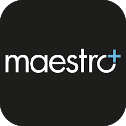

# Maestro MCZ documentation

**From installation to everyday control.**

Bring a stove linked to your Maestro account into Home Assistant. These guides explain how to install the integration, understand its controls, and find the right information when something goes wrong.

[Repository home](../README.md) | [Install now](installation.md) | [Get help](troubleshooting.md)

## Start here

| Your goal | Read this |
|---|---|
| Add Maestro MCZ to Home Assistant | [Installation](installation.md) |
| Connect an account or change the update interval | [Configuration](configuration.md) |
| Understand a control or find a missing entity | [Entities and controls](entities.md) |
| Fix a problem or gather a useful bug report | [Troubleshooting](troubleshooting.md) |
| Suggest or make a correction to these guides | [Maintaining the documentation](maintaining-docs.md) |

## Before you begin

The integration uses the same cloud service as the official Maestro app. First confirm that you can sign in to that app and see your stove online.

<p>
  
  
</p>

The icons above help you recognize the Maestro app. An icon alone does not mean your stove is supported.

## How the connection works

```text
Home Assistant  <-->  Maestro cloud service  <-->  Your stove
```

Home Assistant periodically retrieves cloud data and sends supported commands through the same service. A working connection on one side does not guarantee a working connection on the other; the integration provides separate [cloud and device connection indicators](entities.md#connectivity-and-alarms).

> [!NOTE]
> This setup requires an internet connection and the Maestro cloud; it does not provide Bluetooth or offline control. Available features may differ by installed version. See [Configuration](configuration.md#polling-interval) for polling intervals.

## What to expect

Available controls and settings depend on your stove model, operating mode, and accessories. Not every example in these guides will be available for your stove.

Cloud updates are not instantaneous. After changing a setting, allow time for the stove and cloud to report the new value. The [configuration guide](configuration.md#updates-and-response-time) explains this behavior.

---

**Next:** [Install Maestro MCZ](installation.md)
