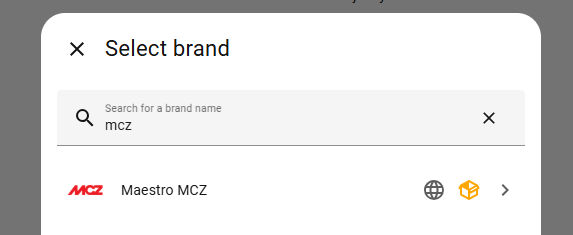

# Installation

[Documentation home](README.md) | [Configuration](configuration.md) | [Troubleshooting](troubleshooting.md)

Installing the integration files and connecting your Maestro account are separate steps. Follow the method for your Home Assistant version, then complete account setup.

## Prerequisites

| Requirement | What to check |
|---|---|
| Home Assistant | Version **2026.3.0 or newer**, as declared by the repository's HACS metadata |
| Maestro account | You can sign in to the official app with your username and password |
| Stove | Already linked to that account and online in the official app |
| Connectivity | Both Home Assistant and the stove can reach the Maestro cloud service |
| Installation access | Administrator access to Marketplace, HACS, or the configuration directory for manual installation |

There is no verified, exhaustive stove-model compatibility list in this project. A cloud-linked stove is a prerequisite, not a guarantee that every feature is supported. See [model-dependent features](entities.md#why-entities-differ-between-stoves).

## Choose an installation method

| Your Home Assistant version | Recommended method |
|---|---|
| 2026.11 or newer | [Built-in Marketplace](#install-with-marketplace) |
| 2026.3-2026.10 | [HACS](#install-with-hacs) |
| Any supported version, without a download manager | [Manual installation](#install-manually) |

Starting with Home Assistant 2026.11, Marketplace replaces the separate HACS integration. Existing HACS downloads and custom repositories carry over. Do not install HACS separately on those versions; see [HACS and Marketplace](https://www.hacs.xyz/docs/marketplace/).

## Install with Marketplace

For **Home Assistant 2026.11 or newer**:

1. Go to **Settings > Marketplace** as an administrator and accept the community-content notice if prompted.
2. Select **Add from link**, enter `https://github.com/Robbe-B/maestro_mcz`, and select **Add**. Connect GitHub if prompted.
3. If asked for a content type, choose **Integration**.
4. Open the added repository, select **Install**, and confirm the version.
5. Follow any restart prompt, then continue with [Add your account](#add-your-account). If the setup dialog opens automatically, use that dialog.

See the [Marketplace custom repository guide](https://www.home-assistant.io/integrations/marketplace/#custom-repositories) if the repository cannot be added.

## Install with HACS

For **Home Assistant 2026.3-2026.10**, with [HACS installed and configured](https://www.hacs.xyz/docs/use/download/download/):

[](https://my.home-assistant.io/redirect/hacs_repository/?owner=Robbe-B&repository=maestro_mcz&category=integration)

1. Open **HACS** in Home Assistant.
2. Open the three-dot menu and select **Custom repositories**.
3. Enter `https://github.com/Robbe-B/maestro_mcz`, choose **Integration** as the type, and select **Add**.
4. Search HACS for **Maestro MCZ (cloud)**, open its page, and download it. Follow the confirmation prompts.
5. Restart Home Assistant, then continue with [Add your account](#add-your-account).

The button above is a shortcut for the older HACS workflow. If it does not work, follow the HACS steps above, or use Marketplace on newer Home Assistant versions. Menu wording can vary between HACS versions; see the [HACS custom repository guide](https://www.hacs.xyz/docs/faq/custom_repositories/).

## Install manually

Use this method if you do not use Marketplace or HACS. You will need to install future updates manually too.

1. Download the source archive for the version you want from [Releases](https://github.com/Robbe-B/maestro_mcz/releases). Prefer the latest stable release unless you intentionally want to test a pre-release.
2. Extract the archive and find `custom_components/maestro_mcz` inside it.
3. Locate your [Home Assistant configuration directory](https://www.home-assistant.io/docs/configuration/) - the folder containing `configuration.yaml`.
4. Create `custom_components` there if needed. Copy the complete `maestro_mcz` folder into it, including all subfolders and assets.
5. Restart Home Assistant, then continue with [Add your account](#add-your-account).

The installed layout should look like this:

```text
<Home Assistant configuration directory>
|-- configuration.yaml
`-- custom_components
    `-- maestro_mcz
        |-- __init__.py
        |-- manifest.json
        |-- config_flow.py
        |-- maestro/
        `-- ...all other integration files and folders
```

> [!IMPORTANT]
> Copy the integration folder, not the whole repository. Avoid an extra nested `maestro_mcz` directory, and do not install the tests or documentation into Home Assistant.

## Add your account

1. Go to **Settings > Devices & services**.
2. Select **Add integration**, search for **Maestro MCZ**, and select it.
3. Enter your **Maestro account** username and password, not your Home Assistant credentials or Wi-Fi password.
4. Complete the dialog and open the integration to inspect the discovered stove devices and entities.



The screenshot is retained from the wiki; the appearance of the dialog may change between Home Assistant versions.

Configuration is through the Home Assistant interface. You do not need to add a `maestro_mcz:` section to `configuration.yaml`.

If setup fails, use the [setup troubleshooting steps](troubleshooting.md#setup-or-sign-in-fails) before removing or reinstalling anything.

## Update

Make a Home Assistant backup and read the [release notes](https://github.com/Robbe-B/maestro_mcz/releases) before updating.

**HACS installation:** download the update through HACS and restart Home Assistant.

**Marketplace installation:** use **Settings > Updates** or the repository's Marketplace page to install the update, then restart Home Assistant.

**Manual installation:** download the desired release and replace the installed integration files with that release's complete `custom_components/maestro_mcz` folder, then restart Home Assistant. Do not mix files from different releases.

Keep pre-releases for deliberate testing. Documentation on `main` can describe changes that are not in your installed stable release.

## Remove

To stop using the integration, remove its entry under **Settings > Devices & services** first. Then uninstall the downloaded integration through Marketplace or HACS, or delete only its `custom_components/maestro_mcz` folder for a manual installation, and restart Home Assistant.

Removing the integration from Home Assistant does not unlink the stove from your Maestro account. Review any dashboards or automations that referenced its entities.

---

**Next:** [Configure your account and polling interval](configuration.md)
